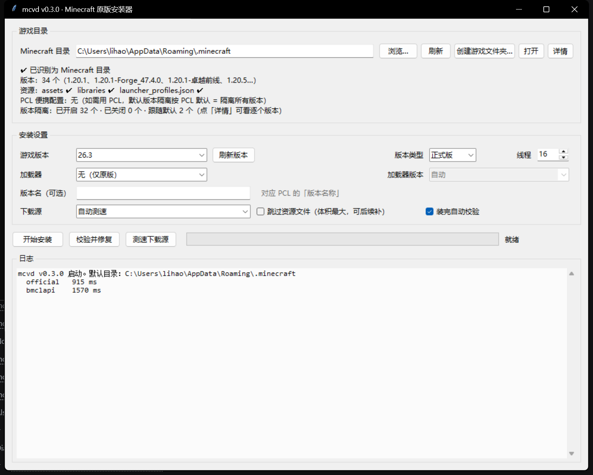
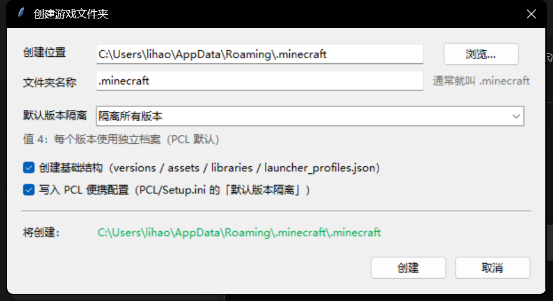

# mc-vanilla-downloader（mcvd）

一个只用 Python 标准库写的 **Minecraft 原版 / 加载器安装器**：从 Mojang 官方或国内镜像（BMCLAPI）把指定版本的客户端、依赖库、资源文件下载到 `.minecraft` 目录，生成 **PCL / HMCL / 官方启动器都能直接识别**的版本。

**默认是图形界面**（双击 exe 即用）：选择下载目录、自动识别已有目录的版本与版本隔离状态、一键创建新的 `.minecraft`；安装 / 校验 / 测速都在后台跑。命令行仍然保留，适合脚本化。



- 多源自动测速选源，单文件失败自动切换镜像
- 断点续传、SHA-1 校验、失败重试、HTTP 连接复用（keep-alive）
- 支持 **Fabric / Quilt / Forge / NeoForge**，支持**自定义版本名**（对应 PCL 的「版本名称」）
- 内置**版本完整性校验与自动修复**（`mcvd verify`）
- 只依赖 Python 3.9+ 标准库，运行时不需 `pip install` 任何东西

> 背景：2026-10-20 起 PCL、HMCL 等在中国大陆展业的启动器陆续关闭了游戏本体下载功能。
> 本工具不在启动器里改任何东西，只是把**官方原版文件**按标准目录结构装好，供**个人自用**。
> 请先阅读 [免责声明](#免责声明)。

## 图形界面（推荐）

双击 `mcvd.exe`，或者运行 `python -m mcvd`（不带参数）。

| 区域 | 能做什么 |
|---|---|
| **游戏目录** | 输入 / 浏览选择任意 `.minecraft`；自动识别是否为 MC 目录、已装版本、assets/libraries/launcher_profiles、**PCL 便携配置与版本隔离**、Java 列表、占用空间；点「详情」看逐个版本的隔离状态 |
| **创建游戏文件夹…** | 选创建位置、文件夹名、**默认版本隔离**（关闭 / 仅隔离可安装 Mod 的版本 / 仅隔离非正式版 / 两者 / 全部，写入 `PCL/Setup.ini` 的 `LaunchArgumentIndieV2`），可勾选是否生成 versions/assets/libraries 基础结构 |
| **安装设置** | 游戏版本（正式版 / 快照 / 全部）、加载器与版本、自定义版本名、下载源（自动测速 / 官方 / BMCLAPI）、线程数、跳过资源、装完自动校验 |
| **操作** | 开始安装 / 校验并修复 / 测速下载源；实时进度条 + 日志 |



「版本隔离」的识别依据（与 PCL 2.9x 一致）：

- 全局默认：`PCL/Setup.ini` 的 `LaunchArgumentIndieV2`（0=关闭，1=隔离可安装 Mod 的版本，2=隔离非正式版，3=两者，4=隔离所有版本）；
- 单版本覆盖：`versions/<id>/PCL/Setup.ini` 的 `VersionArgumentIndieV2`（True/False）；
- 没有配置时：如果版本目录下存在非空的 `mods/` 或 `saves/`，按 PCL 的自动规则判定为「已隔离」。

## 命令行

`mcvd-cli.exe`（或本机 Python 的 `python -m mcvd <命令>`）保留完整 CLI，适合脚本与自动化：

```bash
python -m mcvd gui                 # 打开图形界面
python -m mcvd mirrors             # 测一下官方源和国内镜像哪个快
python -m mcvd list --limit 10     # 看看有哪些版本
python -m mcvd install latest      # 下载最新正式版到 %APPDATA%\.minecraft
mcvd install 1.20.1 --loader forge --name 我的整合包
mcvd verify --fix                  # 校验并修复全部版本
```

| 命令 | 说明 |
|---|---|
| `mcvd`（无参数） | 打开图形界面 |
| `mcvd gui` | 同上（显式） |
| `mcvd mirrors` | 检测官方源与 BMCLAPI 的可用性和耗时 |
| `mcvd list [--type release\|snapshot\|all] [--limit N] [--json]` | 列出可用版本 |
| `mcvd info <版本>` | 查看版本信息 |
| `mcvd loaders <fabric\|quilt> <游戏版本>` | 列出加载器支持的版本 |
| `mcvd install <版本> [--loader ...] [--name NAME]` | 下载并安装原版或加载器版本 |
| `mcvd verify [版本] [--fix]` | 校验已安装版本（默认全部），`--fix` 自动重下 |
| `mcvd tui` | 文字交互菜单（没有图形环境时） |

## 加载器

| 加载器 | 实现方式 | 备注 |
|---|---|---|
| **Fabric** | 拉 `meta.fabricmc.net` 的 profile JSON（`inheritsFrom` 原版），下载其库 | 自动选最新稳定版，`--loader-version` 可指定 |
| **Quilt** | 同上，`meta.quiltmc.org` | |
| **Forge** | 下载官方 `installer.jar`，用本机 Java 执行 `--installClient <目录>` | 自动按游戏版本选 Java（1.20.1→17，1.21→21，1.16.5→8…），也可 `--java` 指定 |
| **NeoForge** | 同 Forge，走 `maven.neoforged.net` | 该 maven 在部分网络下不可达，可用 `--installer` 指定已下载的 installer.jar |

```bash
mcvd install 1.21.4 --loader fabric --loader-version 0.16.9
mcvd install 1.20.1 --loader forge --name 生存服客户端
mcvd install 1.20.1 --loader forge --installer D:\downloads\forge-1.20.1-47.2.0-installer.jar
```

加载器版本会写成 `versions/<名字>/<名字>.json`，`inheritsFrom` 指向原版；PCL / HMCL 会像处理自己装的版本一样处理它。

## 自定义版本名（PCL 的「版本名称」）

`--name`（或界面里的「版本名」）会把版本目录、`<id>.json` 里的 `id`、客户端 jar 文件名统一改成你给的名字：

```bash
mcvd install 1.21.4 --loader fabric --name 原版生存
mcvd install 1.20.1 --name 老版本备份
```

对 Forge/NeoForge（由官方安装器生成目录）会在安装完成后自动重命名目录并改写 JSON。

## 校验与修复

```bash
mcvd verify                    # 校验全部已安装版本
mcvd verify 1.21.4             # 只校验某个版本
mcvd verify --fix              # 发现缺失/损坏的文件自动重新下载
```

校验会沿着 `inheritsFrom` 把父版本（原版）的文件一起算进去，逐文件核对 SHA-1 和大小；资源索引缺失时也会提示。图形界面里点「校验并修复」等价于 `verify --fix`。

## 打包成单文件 exe

```powershell
powershell -ExecutionPolicy Bypass -File packaging/build.ps1
```

会生成两个文件：

- `dist\mcvd.exe` —— 图形界面版（无控制台窗口，双击进入界面）
- `dist\mcvd-cli.exe` —— 命令行版（保留控制台，给脚本用）

## 下载源：官方 vs 国内镜像

`--mirror auto`（默认）会在启动时各拉一次版本清单测速，选快的那个；下载单个文件失败时会自动换另一个源重试。

实测数据见 [docs/MIRRORS.md](docs/MIRRORS.md)，要点：

- **BMCLAPI**（`bmclapi2.bangbang93.com`）是国内事实标准镜像，覆盖版本清单、版本 JSON、客户端 jar、依赖库、资源对象；
- 官方源在本机实测有时比镜像更快（跨境线路好时），所以默认不写死镜像，而是**每次测量**；
- 镜像偶发冷启动慢（首包 10s 级），已做超时 + 重试 + 换源处理，不会卡死。

URL 重写规则（纯函数，见 `src/mcvd/mirrors.py`）：

| 官方域名 | BMCLAPI 路径 |
|---|---|
| `launchermeta.mojang.com` / `piston-meta.mojang.com` / `piston-data.mojang.com` | 同路径 |
| `libraries.minecraft.net/<path>` | `/maven/<path>` |
| `resources.download.minecraft.net/<ab>/<hash>` | `/assets/<ab>/<hash>` |

## 安装出来的目录结构

```
<.minecraft>/
├── versions/<id>/<id>.json     # 版本 JSON（原版或加载器 profile）
├── versions/<id>/<id>.jar      # client.jar（加载器版本通过 inheritsFrom 复用原版）
├── versions/<id>/PCL/Setup.ini # 该版本的独立设置（版本隔离等，PCL 生成）
├── versions/<id>/mcvd-install.json
├── libraries/...               # Maven 布局的依赖库（含 natives）
├── assets/indexes/<id>.json    # 资源索引
├── assets/objects/<ab>/<hash>  # 资源对象（SHA-1 命名）
└── resources/                  # 仅旧版本：map_to_resources 兼容副本
```

安装器不会修改任何启动器文件，也不会写注册表。

## 项目结构

```
src/mcvd/
├── gui.py        # 图形界面（tkinter）
├── detect.py     # 目录识别 / 创建（版本隔离判定）
├── cli.py        # 命令行
├── mirrors.py    # 镜像定义与 URL 重写
├── manifest.py   # 版本清单/版本 JSON 解析
├── rules.py      # libraries 的 rules 判定（os / arch / features）
├── netio.py      # HTTP：多源回退、续传、SHA-1、连接复用
├── installer.py  # 安装编排：客户端、依赖库、资源文件
├── loaders.py    # Fabric / Quilt / Forge / NeoForge
├── java.py       # 查找本机 Java（Forge 安装器需要）
└── verify.py     # 版本完整性校验与修复
packaging/        # PyInstaller 入口与构建脚本
tests/            # 56 个纯离线单元测试
docs/MIRRORS.md   # 镜像调研与实测数据
```

## 测试

```bash
python -m unittest discover -s tests -v
```

单元测试不联网，覆盖 URL 重写、rules 判定、版本选择、路径生成、哈希校验、校验/修复逻辑、目录识别与版本隔离判定、加载器工具函数。

## 开源与致谢

- 代码以 **MIT** 许可发布，见 [LICENSE](LICENSE)。
- 参考的公开规范、镜像服务与启动器行为，全部列在 [NOTICE.md](NOTICE.md)：
  Mojang 版本清单规范、Minecraft Wiki 的 Client.json 文档、**BMCLAPI**（bangbang93 维护的社区镜像）、
  **Fabric / Quilt / Forge / NeoForge 官方 meta 与安装器**、PCL2 / HMCL 的目录约定。
- 本项目**没有复制**任何第三方项目的源代码，也不包含任何游戏文件。

## 免责声明

- 本项目不包含、不托管、不分发任何 Mojang / Microsoft 的游戏文件，所有文件都从官方服务器或公开镜像实时下载。
- 使用前请确保你拥有合法的 Minecraft 账号，并遵守 [Minecraft EULA](https://www.minecraft.net/eula)。
- 仅建议个人自用，请勿用于二次分发游戏内容；请遵守你所在地区的法律法规。
- 因使用本项目产生的一切后果由使用者自行承担。

## License

MIT © 2026 huiyaoxingkong and mcvd contributors
